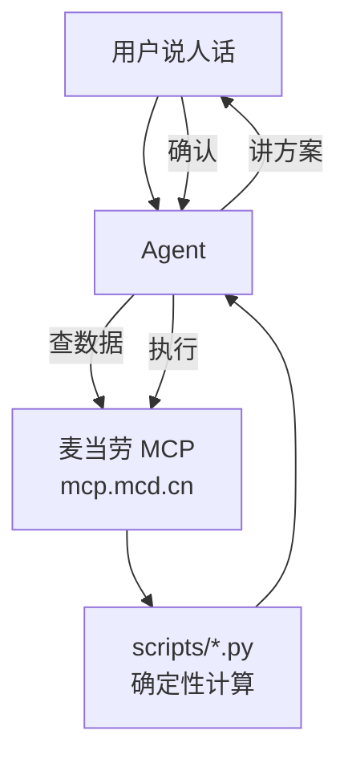

# 麦麦 Skill 全家桶 · mcd-skills

> 四个基于 **麦当劳中国 MCP（McDonald's China MCP）** 的 Agent Skill，一次装全：\
> 积分过期预警、营养配餐、派对一键预约、抽奖期望值计算。\
> 取数交给 MCP，算术交给代码，表达交给 Agent。

[English](#english) · [四个 Skill](#四个-skill) · [一键安装](#一键安装) · [在线演示](#在线演示) · [MCP 接入](MCP_INTEGRATION.md) · [参赛声明](CONTEST_DECLARATION.md)

M-CODE 麦当劳程序员创意开发大赛（1024 程序员节）参赛作品 · 非麦当劳官方产品。

---

## 一句话介绍

四个基于麦当劳中国 MCP 的 Agent Skill，一次装全：积分过期预警、营养配餐、派对一键预约、抽奖期望值计算。每个 Skill 都是"痛点 + 确定性脚本 + 完整 Agent 工作流"的完整形态，开箱即用。

## 四个 Skill

| Skill | 一句话 | 核心 MCP 工具 |
|---|---|---|
| [🛡️ 麦麦积分守卫](skills/mcd-points-guardian/) | "3000 积分 7 天后过期？别让它蒸发"——预警 + 最优兑换 + 一键执行 | `query-my-account`（即将过期积分）、积分商城兑换 |
| [🥗 麦麦营养师](skills/mcd-fitmeal/) | 减脂 / 增肌 / 控糖三模式，7 天配餐计划，蛋白质优先 | `list-nutrition-foods`、`query-meals`、`calculate-price` |
| [🎉 麦麦派对通](skills/mcd-party-buddy/) | 三句话订好一场 10 人生日派对；20 人团建走团餐流程 | 派对四级预约 `query-party-*`、`party-order-create` |
| [🎰 麦麦抽奖精算](skills/mcd-lottery-ev/) | "这期抽奖值不值得抽"——EV 一算便知，玄学退散 | `query-lottery-info`、`draw-lottery`、`query-my-prizes` |

每个 Skill 目录下都有：`SKILL.md`（Agent 行为定义）、`scripts/`（确定性 Python 脚本，仅标准库）、`docs/demo.html`（单文件交互演示）、`examples/`（示例对话）。

## 🖼️ 演示截图

<table>
<tr>
<td><a href="https://zhaojjjjjj.github.io/mcd-skills/demos/points-guardian.html"></a><br/>🛡️ 麦麦积分守卫</td>
<td><a href="https://zhaojjjjjj.github.io/mcd-skills/demos/fitmeal.html"></a><br/>🥗 麦麦营养师</td>
</tr>
<tr>
<td><a href="https://zhaojjjjjj.github.io/mcd-skills/demos/party-buddy.html"></a><br/>🎉 麦麦派对通</td>
<td><a href="https://zhaojjjjjj.github.io/mcd-skills/demos/lottery-ev.html"></a><br/>🎰 麦麦抽奖精算</td>
</tr>
</table>

> 静态演示页（含可交互抽奖机），页面内数据均为演示用模拟数据。统一导航：[在线演示](https://zhaojjjjjj.github.io/mcd-skills/)。

## 一键安装

```bash
curl -fsSL https://zhaojjjjjj.github.io/mcd-skills/install.sh | bash
```

一行命令装好四个 Skill（Windows 请在 Git Bash 里运行）。只想要某一个？

```bash
curl -fsSL https://zhaojjjjjj.github.io/mcd-skills/install.sh | bash -s -- --only mcd-lottery-ev
```

<details>
<summary>手动安装（不想 pipe to bash 的看这里）</summary>

```bash
git clone --depth 1 https://github.com/Zhaojjjjjj/mcd-skills.git
mkdir -p ~/.workbuddy/skills
cp -r mcd-skills/skills/* ~/.workbuddy/skills/
```

</details>

四条 Skill 一次装全。Cherry Studio / Cursor / VS Code / Trae 等支持 MCP 的客户端可按各自方式加载 `SKILL.md`。

只想要其中一个？比如：

```bash
cp -r mcd-skills/skills/mcd-lottery-ev ~/.workbuddy/skills/
```

## 在线演示

打开 [在线演示](https://zhaojjjjjj.github.io/mcd-skills/)，四个 Skill 的交互演示一页直达（本地双击 `docs/index.html` 也可看）：
单文件、零依赖、数据均为演示用模拟数据。

## 通用架构

四个 Skill 同一个设计哲学，来自领先项目的验证：**取数交给 MCP，算术交给代码，表达交给 Agent**。



大模型不心算——价格、EV、营养组合全部由脚本确定性算出，结果可复现、可解释。

## 仓库结构

```
mcd-skills/
├── README.md                  # 你正在看的
├── skills/
│   ├── mcd-points-guardian/   # 🛡️ 积分过期管家
│   ├── mcd-fitmeal/           # 🥗 营养配餐
│   ├── mcd-party-buddy/       # 🎉 派对一键预约
│   └── mcd-lottery-ev/        # 🎰 抽奖期望值
├── docs/
│   └── index.html             # 四个演示的统一导航页
├── MCP_INTEGRATION.md         # MCP Token 申请与接入
├── CONTEST_DECLARATION.md     # 参赛声明
├── LICENSE                    # MIT
└── .gitignore
```

---

## English

**mcd-skills** — Four Agent Skills built on McDonald's China MCP, install all at once:

- 🛡️ **mcd-points-guardian**: points expiry alerts + optimal redemption + one-click execution
- 🥗 **mcd-fitmeal**: nutrition meal planner (cutting / bulking / low-carb modes + 7-day plans)
- 🎉 **mcd-party-buddy**: birthday party & team dinner booking via McDonald's party reservation tools
- 🎰 **mcd-lottery-ev**: expected-value calculator for the points lottery — "is this round worth it?"

Each skill ships a `SKILL.md` (agent behavior), deterministic Python scripts (stdlib only),
a single-file interactive demo page, and example conversations.
Built for the M-CODE McDonald's China Developer Creative Competition (1024 Programmers' Day).
Not an official McDonald's product.

## License

MIT — see [LICENSE](LICENSE).
