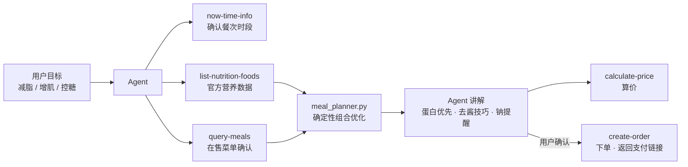

# 🍔 mcd-fitmeal · 麦麦营养师

> **减脂 / 增肌 / 控糖人群也能吃麦当劳。** 说出你的目标，Skill 用麦当劳官方营养数据为你搭配出达标套餐，并可一键下单。

**减脂午餐示例**：麦香鸡（去酱版）+ 玉米杯 → **485 kcal / 32g 蛋白质** ✅ 达标

---

**English**: mcd-fitmeal is an Agent Skill built on McDonald's China MCP. Tell it your goal — cutting, bulking, or sugar control — and it composes macro-compliant meal combos from official nutrition data, with a 7-day planner and one-click ordering.


## 它解决什么问题

- **健身人群点餐焦虑**：想吃麦当劳，又怕热量超标、蛋白质不够，每次点单都要做阅读理解。
- **营养信息不透明**：菜单上有热量数字，但"怎么搭配才达标"没人告诉你。
- **计划难坚持**：单次搭配容易，一周三餐的饮食计划没人帮你排。

mcd-fitmeal = 说出目标 → 拉官方营养数据 → 确定性算法组合优化 → 讲解搭配 → 算价 → 确认下单，全链路闭环。

## 三种模式

| 模式 | 默认目标 | 策略 |
|------|---------|------|
| 🔥 减脂 `cut` | 400–600 kcal，蛋白 ≥ 30g | 蛋白质密度优先；去酱 / 酱另放；饮料选无糖 |
| 💪 增肌 `bulk` | 700–1000 kcal，蛋白 ≥ 45g | 热量盈余 + 高蛋白，可加一份蛋白小食 |
| 🍃 控糖 `sugar` | 400–700 kcal，蛋白 ≥ 25g，碳水 ≤ 45g | 避含糖饮料，低碳水搭配 |

用户给出的具体数字永远优先于默认值。

## 架构



核心设计：**组合优化用确定性脚本完成，不靠 LLM 心算**——结果可复现、可解释、可测试（见 `scripts/meal_planner.py`）。

## 快速开始

### 1. 申请 MCP Token

到麦当劳 MCP 开放平台 [open.mcd.cn/mcp](https://open.mcd.cn/mcp) 手机号登录 → 控制台激活 Token。详细步骤见 [MCP_INTEGRATION.md](../../MCP_INTEGRATION.md)。

### 2. 一键安装

```bash
git clone https://github.com/Zhaojjjjjj/mcd-skills.git && cp -r mcd-skills/skills/mcd-fitmeal ~/.workbuddy/skills/
```

Skill 为标准目录规范（`SKILL.md` + `scripts/`），Cherry Studio / Cursor / VS Code / Trae 等支持 MCP 的客户端可按各自方式加载。

### 3. 接入 MCP

在客户端 MCP 配置中加入（Token 替换为你自己的）：

```json
{
  "mcpServers": {
    "mcd-mcp": {
      "type": "streamablehttp",
      "url": "https://mcp.mcd.cn",
      "headers": { "Authorization": "Bearer <YOUR_MCP_TOKEN>" }
    }
  }
}
```

### 4. 直接开聊

> 你减脂期，午餐 500 大卡以内、蛋白质 30g 以上，帮我搭一套

> 我增肌，训练后要吃 800 大卡、蛋白 50g，直接下单

## 示例对话

- [减脂期午餐](examples/cut-lunch.md) —— 目标确认 → 搭配 → 算价 → 下单
- [增肌期训练后加餐](examples/bulk-postworkout.md) —— 高蛋白加餐 + 预算约束
- [在线演示页](docs/demo.html) —— 静态交互模拟（示例数据，直接浏览器打开）


## 确定性配餐脚本

```bash
# 减脂演示（内置示例菜单）
python3 scripts/meal_planner.py --demo

# 用 MCP 真实数据（nutrition.json）按增肌目标规划
python3 scripts/meal_planner.py --data nutrition.json --mode 增肌 --top 5

# 覆盖默认目标 + JSON 输出
python3 scripts/meal_planner.py --data nutrition.json --mode 控糖 \
  --cal-max 600 --protein-min 30 --carbs-max 40 --json
```

仅依赖 Python 标准库，`python3 scripts/meal_planner.py --help` 查看全部参数。

## 仓库结构

```
mcd-skills/skills/mcd-fitmeal/
├── README.md              # 本文件
├── SKILL.md               # Skill 本体（模式定义 / 工作流 / 搭配原则）
├── scripts/
│   └── meal_planner.py    # 确定性配餐脚本（仅标准库）
├── docs/
│   └── demo.html          # 单文件静态演示页
└── examples/
    ├── cut-lunch.md       # 示例对话：减脂期午餐
    └── bulk-postworkout.md# 示例对话：增肌期训练后加餐
└── .gitignore
```

## 参赛声明

本项目为 **麦当劳 M-CODE 程序员创意开发大赛**（1024 程序员节，2026-10-09 — 2026-10-25）参赛作品，**非麦当劳官方产品**。营养数据来源于麦当劳中国官方 MCP 服务，仅供参考。详见 [CONTEST_DECLARATION.md](../../CONTEST_DECLARATION.md)。

## License

MIT — 详见 [LICENSE](LICENSE)。
