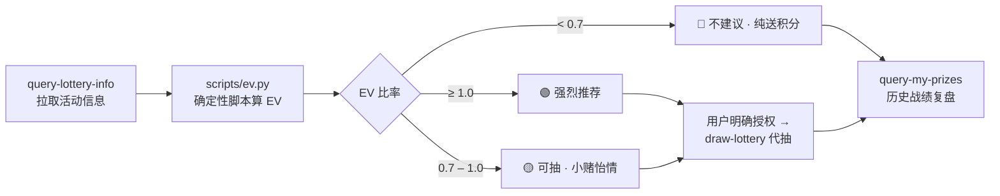

# 🎰 mcd-lottery-ev · 麦麦抽奖精算

> **"这期抽奖 EV = 0.78，单抽期望亏 22% 积分——免费次数抽完就收手，剩下的积分留着换巨无霸。"**
>
> *An Agent Skill that computes the Expected Value (EV) of McDonald's China loyalty-points lottery draws via the official McDonald's MCP, and tells you — with math, not vibes — whether this round is worth your points.*


## 它解决什么问题

每个麦门信徒都经历过：看到"积分抽奖"四个字就上头，500 积分梭哈下去，换回五个"谢谢参与"和一晚上睡不着。

积分不是大风刮来的。**mcd-lottery-ev** 在你上头之前，先帮你算一笔账：

- 📊 拉取本期抽奖活动信息（奖品列表、概率、单抽消耗、你的免费次数）
- 🧮 用确定性脚本算出单抽期望值（EV）和回本率
- 🎯 直接给结论：**强烈推荐 / 可抽 / 不建议**，阈值公开透明
- 📉 还能复盘你的历史战绩：上个月到底是赚是亏，数据说话

玄学退散，数学留下。

## 工作原理



EV 口径完全透明：`单抽期望回报 = Σ(奖品概率 × 奖品估算价值)`，`EV 比率 = 期望回报 ÷ 单抽成本`。餐品按官方售价、优惠券按面额 × 核销率、积分按单价折算——所有假设都会在输出里明示，详见 `skills/mcd-lottery-ev/SKILL.md`。

## 一键安装

```bash
git clone https://github.com/Zhaojjjjjj/mcd-skills.git
cp -r mcd-skills/skills/mcd-lottery-ev ~/.workbuddy/skills/
```

然后按 [`MCP_INTEGRATION.md`](../../MCP_INTEGRATION.md) 接入麦当劳 MCP（去 open.mcd.cn/mcp 申请 Token，两分钟搞定），在 WorkBuddy 里直接问：

> "这期积分抽奖值不值得抽？"

## 示例对话

**你**：这期抽奖值不值得抽？

**Skill**：查到了，本期「金秋抽奖」共 4 档奖品，单抽消耗 100 积分，你还有 2 次免费机会。脚本算出来了：

- 单抽期望回报 0.78 元，成本约 1.00 元，**EV = 0.78**
- 结论：🟡 **可抽**——期望小亏 22%，就当买个开心
- 建议：先把 2 次免费次数抽完，积分抽最多再来 3 次，见好就收

（完整对话见 [`examples/`](examples/)）

## 在线演示

`docs/demo.html` 是单文件演示页（双击用浏览器打开即可）

，模拟"查活动 → 算 EV → 出建议 → 抽奖 → 战绩"全流程，还附带一个停不下来的抽奖机。**页面内数据均为演示用模拟数据。**

## 仓库结构

```
mcd-lottery-ev/
mcd-skills/skills/mcd-lottery-ev/
├── README.md            # 本文件
├── SKILL.md             # Skill 本体（WorkBuddy / Cherry Studio / Cursor 通用）
├── scripts/ev.py        # EV 计算脚本（仅 Python 标准库）
├── docs/demo.html       # 单文件演示页（含抽奖机动画）
└── examples/            # 示例对话 × 2
```

## 参赛声明

本项目为 **麦当劳 M-CODE 程序员创意开发大赛（1024 程序员节）** 参赛作品，**非麦当劳官方产品**。详见 [CONTEST_DECLARATION.md](../../CONTEST_DECLARATION.md)。

## License

MIT © 2026 Zhaojjjjjj
