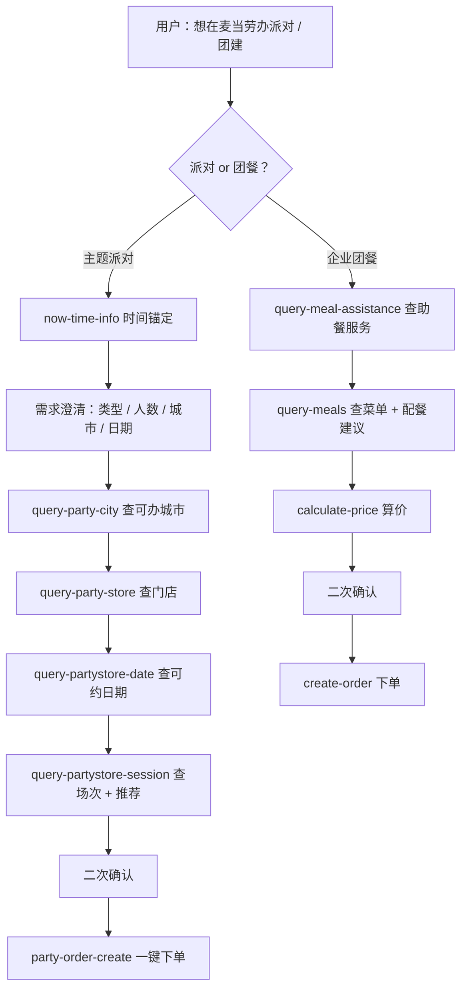

# mcd-party-buddy · 麦麦派对通 🎉🍔

> **三句话订好一场 10 人生日派对**——你说需求，我查场次，你点确认。
>
> *Book a 10-person birthday party at McDonald's in three sentences — you state the need, I check availability, you confirm.*

麦麦派对通是一个基于**麦当劳官方 MCP** 的 Agent Skill：当你想在麦当劳办生日派对、主题活动或公司团建时，它用对话收集「城市 → 门店 → 日期 → 场次」四级信息，实时查询可用场次并推荐，下单前二次确认，一键创建派对订单。企业团建则走团餐流程（查助餐服务 → 查菜单 → 算价 → 下单）。

## 解决什么问题

- **信息散**：哪些城市/门店能办派对、哪天有场次，分散在各处，家长和行政要一个个问。
- **流程长**：传统方式要打电话、加微信、等回复，Skill 把"问-查-订"收敛到一次对话。
- **怕踩坑**：人数怎么配餐、提前多久订、忌口怎么办——Skill 内置了这些经验（见 `scripts/party_checklist.py`）。

## 架构



## 一键安装

```bash
git clone https://github.com/Zhaojjjjjj/mcd-skills.git && cp -r mcd-skills/skills/mcd-party-buddy ~/.workbuddy/skills/
```

前置条件：

1. 在 [open.mcd.cn/mcp](https://open.mcd.cn/mcp) 申请 MCP Token（手机号登录 → 控制台激活）。
2. 在你的 MCP Client（WorkBuddy / Cherry Studio / Cursor / Trae / VSCode）中接入 `https://mcp.mcd.cn`（Streamable HTTP，`Authorization: Bearer <你的Token>`）。详细步骤见 [MCP_INTEGRATION.md](../../MCP_INTEGRATION.md)。

然后直接对 AI 说：**"我女儿下周六过生日，想在麦当劳办派对"**。

## 示例对话

**生日派对**（完整对话见 [`examples/birthday-party.md`](./examples/birthday-party.md)）：

> 用户：我女儿下周六过生日，想在麦当劳办派对，大概 10 个小朋友
> 助手：太棒了！先确认几个信息：1. 10 位都是小朋友吗？2. 哪个城市？3. 下周六是 10 月 17 日对吗？
> 用户：8 个小朋友 2 个大人，上海，日期对
> 助手：上海有 12 家门店支持主题派对……推荐麦当劳南京东路餐厅，可以吗？
> ……（查日期 → 查场次 → 推荐下午场 → 二次确认）
> 用户：确认下单
> 助手：🎊 预约成功！订单号 MCD-20261017-8814

**企业团建**（完整对话见 [`examples/team-meal.md`](./examples/team-meal.md)）：20 人团建走团餐流程，查助餐服务 → 配餐（含 2 素食 1 清真）→ `calculate-price` 算出实付 ¥928 → 确认 → 下单。

也可以在浏览器里点开 [`docs/demo.html`](./docs/demo.html) 看四步预约流程的交互演示。


## 仓库结构

```
mcd-party-buddy/
mcd-skills/skills/mcd-party-buddy/
├── README.md                  # 本文件
├── SKILL.md                   # Skill 本体（Agent 行为定义）
├── scripts/party_checklist.py # 派对筹备 checklist 生成器（纯标准库）
├── docs/demo.html             # 单文件交互演示页
└── examples/                  # 示例对话（生日派对 / 企业团建）
```

## 参赛声明

本项目为 **M-CODE 麦当劳程序员创意开发大赛**参赛作品，**非麦当劳官方产品**，与麦当劳中国无关。详见 [CONTEST_DECLARATION.md](./CONTEST_DECLARATION.md)。

## License

MIT © 2026 zhaojjjjjj
