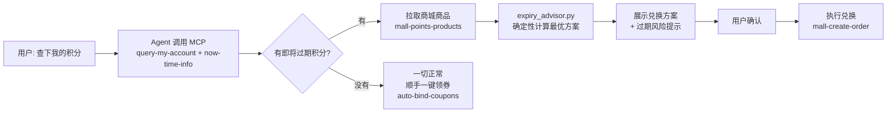

# 🍔 麦麦积分守卫 · mcd-points-guardian


> **3000 积分 7 天后过期？别让它蒸发。** 麦麦积分守卫定期检查你的麦当劳积分账户，算出最值的兑换路径，经你确认后一键兑换——过期预警 + 最优方案 + 一键执行。

[English](#english) · [MCP 接入说明](../../MCP_INTEGRATION.md) · [示例对话](examples/) · [参赛声明](../../CONTEST_DECLARATION.md)

## 它解决什么问题

- 麦当劳积分会过期，过期 = 白白亏钱，但 App 里不会主动喊你。
- 商城里能换的东西太多：哪个最值、换几个能正好 cover 掉快过期的积分，人工算不动。
- 已有方案多是"算算积分值多少钱"，我们是**行动派**：预警 → 给方案 → 你点头 → 直接换。

## 它是怎么工作的



Agent 负责取数和执行，`scripts/expiry_advisor.py` 负责**确定性**的排序计算（同样的输入永远得到同样的输出，不靠模型拍脑袋）。任何兑换动作都必须用户确认，大额兑换二次确认。完整行为规范见 [skills/mcd-points-guardian/SKILL.md](skills/mcd-points-guardian/SKILL.md)。

## 快速开始

前置：任意支持 MCP Streamable HTTP 的客户端（WorkBuddy / Cherry Studio / Cursor / Trae / VS Code），以及麦当劳 MCP Token（[2 分钟申请](../../MCP_INTEGRATION.md)）。

```bash
curl -fsSL https://zhaojjjjjj.github.io/mcd-skills/install.sh | bash -s -- --only mcd-points-guardian

# 2. 在客户端里配好麦当劳 MCP（见 MCP_INTEGRATION.md），然后直接说：
# "帮我检查下麦当劳积分有没有快过期的"
```

想先看效果？

- 在线试玩：[演示页](https://zhaojjjjjj.github.io/mcd-skills/demos/points-guardian.html)（本地双击 `docs/demo.html` 也可看）


- 或直接跑确定性脚本（内置演示数据，零配置）：

```bash
python3 scripts/expiry_advisor.py
```

## 示例对话

```
👤：我麦当劳积分是不是有快过期的？帮我看看

🤖：查到了：你有 8000 可用积分，其中 3000 将在 7 天后过期（🟠偏高风险）。
    按当前商城，最值的换法是「麦辣鸡腿堡单人餐券 ×2」——花 5000 积分，
    约值 ¥50，一次性救下全部 7 天后到期的积分。要换吗？

👤：换

🤖：✅ 已兑换！订单号 MCD20261010xxxx，2 张券已到账（有效期 30 天）。
    顺手帮你一键领了 3 张麦麦省券。剩下 1500 积分 30 天后过期，
    不着急，下个月我再提醒你。
```

更多完整对话：[上班族的 8000 积分](examples/office-worker.md) · [薅券党的组合拳](examples/coupon-hunter.md)

## 兑换策略（确定性脚本，与 SKILL.md 一致）

1. **过期优先**：兑换永远先消耗"即将过期"的积分，再动长期有效的。
2. **单位积分价值最大**：按 `每千积分价值 = 预估价值 ÷ 积分成本 × 1000` 排序。
3. **风险分级**：≤3 天 🔴紧急 / ≤7 天 🟠偏高 / ≤14 天 🟡注意 / >14 天 🟢健康。
4. **执行前确认**：任何兑换必须用户点头；单次 ≥5000 积分二次确认。

## 仓库结构

```
mcd-skills/skills/mcd-points-guardian/
├── README.md                # 你正在看的
├── SKILL.md                 # Skill 本体：工作流 / 策略 / 边界
├── scripts/
│   └── expiry_advisor.py    # 确定性兑换顾问（仅标准库）
├── docs/
│   └── demo.html            # 单文件交互演示页
└── examples/
    ├── office-worker.md     # 示例：上班族的 8000 积分
    └── coupon-hunter.md     # 示例：薅券党的组合拳
```

## <a id="english"></a>English

**mcd-points-guardian** is an Agent Skill built on McDonald's China MCP for the M-CODE Developer Innovation Challenge (1024 Programmers' Day). It watches your McDonald's loyalty points, warns you before they expire, computes the optimal redemption plan deterministically, and redeems with one click after your confirmation. Expiring points = lost money — this skill makes sure that never happens quietly.

## 参赛声明

本项目为 **M-CODE 麦当劳程序员创意开发大赛**参赛作品，由个人开发者独立开发，**非麦当劳官方产品**，仅作非商业的技术演示与参赛用途。详见 [CONTEST_DECLARATION.md](../../CONTEST_DECLARATION.md)。

## License

MIT — 详见 [LICENSE](LICENSE)。
